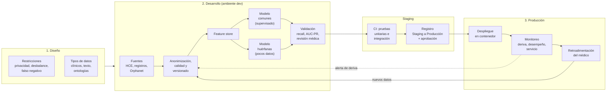

# Brief: Pipeline de MLOps para predicción de enfermedades comunes y huérfanas

Documento vivo. Parte 1 de la entrega (Semanas 1 y 2). La parte 2 (servicio en Docker) está en [`api/`](../api/) y [`app/`](../app/); su instalación y uso están en el [README](../README.md).

---

## 1. Resumen ejecutivo

**Problema.** Dados los síntomas de un paciente, estimar si es posible que sufra alguna enfermedad y apoyar así la decisión del médico.

**Por qué no es un solo modelo.** Hay dos regímenes de datos muy distintos:

| | Enfermedades comunes | Enfermedades huérfanas |
|---|---|---|
| Datos disponibles | Abundantes | Muy escasos (decenas o pocos cientos de casos) |
| Riesgo principal | Desbalance moderado, sesgos de población | Sobreajuste, validación poco confiable |
| Enfoque | Aprendizaje supervisado clásico | Transferencia de aprendizaje, pocos ejemplos, datos sintéticos y conocimiento experto |

El pipeline propuesto cubre ambos casos con un flujo común (datos, validación, despliegue, monitoreo) y ramas de modelado distintas. El sistema es un **apoyo a la decisión clínica**: la decisión final siempre es del médico.

---

## 2. Diseño

### 2.1 Restricciones y limitaciones

- **Privacidad y normativa.** Los datos de salud son sensibles. En Colombia aplica la Ley 1581 de 2012 (protección de datos personales); se requiere consentimiento, minimización y anonimización.
- **Desbalance de clases.** Los casos positivos de enfermedades raras son una fracción mínima del total.
- **Escasez de datos en huérfanas.** Pocos casos, dispersos en varias instituciones.
- **Costo asimétrico del error.** Un falso negativo (no detectar una enfermedad) es mucho más grave que un falso positivo; se prioriza el *recall* con un umbral ajustable.
- **Explicabilidad.** El médico debe entender por qué el modelo sugiere un resultado.
- **Sesgo y representatividad.** Los datos pueden subrepresentar ciertos grupos de edad, sexo o regiones.
- **Calidad de datos.** Historias clínicas incompletas, ruidosas y con criterios de registro heterogéneos.

### 2.2 Tipos de datos

| Tipo | Ejemplos |
|---|---|
| Estructurados | Signos vitales, edad, sexo, resultados de laboratorio, códigos diagnósticos (CIE-10) |
| Semiestructurados | Listas de síntomas codificados (p. ej. ontología HPO) |
| Texto libre | Notas clínicas y descripciones del médico |
| Imágenes y señales (opcional) | Radiografías, ECG |
| Conocimiento externo | Bases de enfermedades raras y literatura médica |

---

## 3. Desarrollo

### 3.1 Fuentes y manejo de datos

- **Fuentes:** historias clínicas electrónicas (estándares HL7/FHIR), registros de enfermedades raras, bases de conocimiento como Orphanet y literatura científica.
- **Ingesta y anonimización:** eliminación de identificadores directos, seudonimización de los restantes.
- **Calidad:** validación de esquema, rangos y valores faltantes; reglas de depuración documentadas.
- **Ingeniería de características:** normalización de síntomas a un vocabulario común, codificación y tratamiento de faltantes. Las características se guardan en un **repositorio de características** (*feature store*) para usar exactamente las mismas en entrenamiento y en inferencia.
- **Versionado:** datos, características y código versionados para poder reproducir cualquier entrenamiento.

### 3.2 Modelos candidatos

- **Enfermedades comunes (muchos datos):** modelos supervisados clásicos (regresión logística, árboles potenciados por gradiente, bosques aleatorios), con posibilidad de redes neuronales si el volumen lo justifica. Se prefieren modelos interpretables como línea base.
- **Enfermedades huérfanas (pocos datos):**
  - *Transferencia de aprendizaje*: reutilizar representaciones aprendidas con enfermedades comunes o con texto médico.
  - *Aprendizaje con pocos ejemplos* (few-shot) y modelos basados en similitud entre pacientes o fenotipos.
  - *Datos sintéticos* y aumento de datos, validados por expertos.
  - *Reglas expertas* y conocimiento de ontologías como complemento o respaldo del modelo estadístico.
- **Combinación:** un modelo general propone candidatos y los módulos especializados refinan el resultado para enfermedades raras.

### 3.3 Validación y pruebas

- **Partición estratificada** y validación cruzada para conservar la proporción de clases.
- **Métricas adecuadas al desbalance:** *recall* (sensibilidad), precisión, AUC-PR y calibración de probabilidades; la exactitud global no es suficiente.
- **Validación externa** con datos de otra institución o periodo.
- **Revisión médica** de casos y de la explicabilidad antes de aprobar un modelo.
- **Pruebas de equidad** por subgrupos (edad, sexo, región).
- **Pruebas de software:** unitarias, de integración y del servicio de inferencia.

---

## 4. Producción

- **Despliegue:** el modelo se empaqueta en un **contenedor Docker** expuesto como servicio (API y, opcionalmente, interfaz web) que el médico puede ejecutar en su propio sistema. La parte 2 de esta entrega implementa esta idea con una función simulada en lugar de un modelo entrenado (ver [`api/`](../api/) y [`app/`](../app/)).
- **Formato portable del modelo (opcional):** exportar el modelo entrenado a **ONNX**, un formato abierto de modelos de ML, y servirlo con un motor de inferencia compatible. Así el servicio no depende de la librería con la que se entrenó cada modelo (útil porque comunes y huérfanas pueden usar técnicas distintas), y la inferencia suele ser más rápida y la imagen más liviana.
- **Registro de modelos:** cada versión se guarda con sus datos, métricas y parámetros, y pasa por las etapas *Ninguna → Staging → Producción* (por ejemplo, con MLflow). La promoción a producción requiere **aprobación humana**, y siempre se puede volver a la versión anterior.
- **Monitoreo:**
  - *Deriva de datos* (cambios en la distribución de los síntomas de entrada).
  - *Desempeño* frente a diagnósticos confirmados posteriormente.
  - *Salud del servicio* (latencia, errores, disponibilidad).
  - Las métricas se guardan en **tablas de métricas** con umbrales que disparan alertas.
- **Retroalimentación médica:** el médico confirma o corrige el resultado; esas correcciones se convierten en nuevos datos etiquetados.
- **Reentrenamiento:** se dispara por calendario o por alertas de deriva/desempeño, y vuelve a pasar por validación y aprobación. En huérfanas, cada caso nuevo confirmado es especialmente valioso.

---

## 5. Ambientes y CI/CD

El pipeline se ejecuta en tres ambientes separados, para que ningún cambio llegue al médico sin haber pasado por pruebas:

| Ambiente | Qué ocurre | Rama |
|---|---|---|
| **Desarrollo** | Análisis exploratorio, ingeniería de características y entrenamiento con datos anonimizados | `dev` |
| **Staging** | Pruebas automáticas (CI) sobre el modelo ya validado, que queda en el registro en etapa *Staging* | `stage` |
| **Producción** | Despliegue del servicio, inferencia, monitoreo y recolección de la retroalimentación médica | `main` + etiqueta de versión |

- **Control de versiones:** el código avanza por `feature/*` → `dev` → `stage` → `main` mediante *pull requests* revisados, y cada entrega lleva una etiqueta (`vX.Y.Z`). Este mismo repositorio sigue ese flujo (ver [`CONTRIBUTING.md`](../CONTRIBUTING.md)).
- **Integración continua (CI):** cada cambio ejecuta pruebas unitarias (funciones de datos y del modelo) y de integración (el servicio de punta a punta). Si fallan, el cambio no avanza. En este repositorio se corren con `make lint typecheck test`.
- **Despliegue continuo (CD):** cuando un modelo pasa de *Staging* a *Producción* en el registro, con aprobación humana, se construye una nueva imagen del contenedor con esa versión y se publica.

---

## 6. Diagrama general

El flujo avanza de izquierda a derecha: el diseño define restricciones y datos; en desarrollo los datos se preparan y alimentan dos modelos que se validan juntos; en staging se prueban y se registran; en producción se despliegan y se monitorean. La retroalimentación del médico y las alertas de deriva del monitoreo vuelven a la preparación de datos y cierran el ciclo de reentrenamiento.

---

## 7. Plan de ejecución

Un proyecto real que ejecute este pipeline avanzaría por fases, cada una con un criterio claro para pasar a la siguiente:

| Fase | Alcance | Criterio para avanzar |
|---|---|---|
| **1. Datos** | Acuerdos con instituciones, anonimización, vocabulario común de síntomas y *feature store* | Datos de al menos dos instituciones validados en calidad |
| **2. Modelo de comunes** | Línea base interpretable, validación externa y piloto con un grupo pequeño de médicos | *Recall* y calibración por encima del umbral acordado con los médicos |
| **3. Módulo de huérfanas** | Transferencia desde el modelo de comunes, reglas basadas en Orphanet y revisión de especialistas | Validación caso a caso por especialistas |
| **4. Operación continua** | Monitoreo, retroalimentación y reentrenamiento automatizados | Alertas y reentrenamiento probados en staging |

Empezar por las enfermedades comunes tiene dos ventajas: pone en marcha toda la infraestructura de MLOps con el caso que tiene más datos, y deja listo el modelo base del que aprende el módulo de huérfanas. La parte 2 de esta entrega corresponde al despliegue del piloto, con una función simulada en lugar del modelo.

---

## 8. Riesgos y ética

| Riesgo | Mitigación |
|---|---|
| Fuga o reidentificación de datos de pacientes | Anonimización, acceso restringido, cumplimiento de la Ley 1581 de 2012 |
| Falsos negativos con consecuencias clínicas | Umbral orientado a *recall*, el médico decide siempre, mensajes claros de incertidumbre |
| Sesgo contra grupos poco representados | Pruebas de equidad por subgrupo, ampliación de fuentes de datos |
| Sobreajuste en enfermedades huérfanas | Validación externa, regularización, revisión de expertos |
| Confianza excesiva en el sistema | Explicaciones, trazabilidad de versión del modelo, uso declarado como apoyo y no como diagnóstico |
| Deriva del modelo con el tiempo | Monitoreo continuo y reentrenamiento con aprobación |

---

## 9. Referencias

- Enunciado de la unidad: Semanas 1-2, Pipeline de MLOps + imagen de Docker.
- Material de clase: DevOps en MLOps, diferentes ambientes (desarrollo, staging y producción).
- MLflow: plataforma de código abierto para el registro y ciclo de vida de modelos.
- ONNX (Open Neural Network Exchange): formato abierto para intercambiar y desplegar modelos de ML, https://onnx.ai
- Orphanet: portal de enfermedades raras y medicamentos huérfanos.
- HL7 FHIR: estándar de intercambio de información clínica.
- Ley 1581 de 2012 (Colombia): protección de datos personales.
