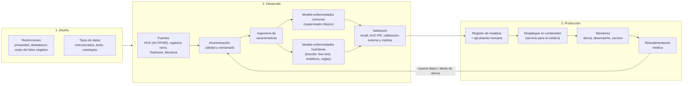

# Brief: Pipeline de MLOps para predicción de enfermedades comunes y huérfanas

Documento vivo. Parte 1 de la entrega (Semanas 1 y 2). La parte 2 (servicio en Docker) está en construcción en [`backend/`](../backend/) y [`frontend/`](../frontend/); su instalación y uso se documentarán en el [README](../README.md).

---

## 1. Resumen ejecutivo

**Problema.** Dados los síntomas de un paciente, estimar si es posible que sufra alguna enfermedad y apoyar así la decisión del médico.

**Por qué no es un solo modelo.** Hay dos regímenes de datos muy distintos:

| | Enfermedades comunes | Enfermedades huérfanas |
|---|---|---|
| Datos disponibles | Abundantes | Muy escasos (decenas o pocos cientos de casos) |
| Riesgo principal | Desbalance moderado, sesgos de población | Sobreajuste, validación poco confiable |
| Enfoque | Aprendizaje supervisado clásico | Transferencia de aprendizaje, pocos ejemplos, datos sintéticos y conocimiento experto |

El pipeline propuesto cubre ambos casos con un flujo común (datos, validación, despliegue, monitoreo) y ramas de modelado distintas. El sistema es un **apoyo a la decisión clínica**: la decisión final siempre es del médico.

---

## 2. Diseño

### 2.1 Restricciones y limitaciones

- **Privacidad y normativa.** Los datos de salud son sensibles. En Colombia aplica la Ley 1581 de 2012 (protección de datos personales); se requiere consentimiento, minimización y anonimización.
- **Desbalance de clases.** Los casos positivos de enfermedades raras son una fracción mínima del total.
- **Escasez de datos en huérfanas.** Pocos casos, dispersos en varias instituciones.
- **Costo asimétrico del error.** Un falso negativo (no detectar una enfermedad) es mucho más grave que un falso positivo; se prioriza el *recall* con un umbral ajustable.
- **Explicabilidad.** El médico debe entender por qué el modelo sugiere un resultado.
- **Sesgo y representatividad.** Los datos pueden subrepresentar ciertos grupos de edad, sexo o regiones.
- **Calidad de datos.** Historias clínicas incompletas, ruidosas y con criterios de registro heterogéneos.

### 2.2 Tipos de datos

| Tipo | Ejemplos |
|---|---|
| Estructurados | Signos vitales, edad, sexo, resultados de laboratorio, códigos diagnósticos (CIE-10) |
| Semiestructurados | Listas de síntomas codificados (p. ej. ontología HPO) |
| Texto libre | Notas clínicas y descripciones del médico |
| Imágenes y señales (opcional) | Radiografías, ECG |
| Conocimiento externo | Bases de enfermedades raras y literatura médica |

---

## 3. Desarrollo

### 3.1 Fuentes y manejo de datos

- **Fuentes:** historias clínicas electrónicas (estándares HL7/FHIR), registros de enfermedades raras, bases de conocimiento como Orphanet y literatura científica.
- **Ingesta y anonimización:** eliminación de identificadores directos, seudonimización de los restantes.
- **Calidad:** validación de esquema, rangos y valores faltantes; reglas de depuración documentadas.
- **Ingeniería de características:** normalización de síntomas a un vocabulario común, codificación y tratamiento de faltantes.
- **Versionado:** datos, características y código versionados para poder reproducir cualquier entrenamiento.

### 3.2 Modelos candidatos

- **Enfermedades comunes (muchos datos):** modelos supervisados clásicos (regresión logística, árboles potenciados por gradiente, bosques aleatorios), con posibilidad de redes neuronales si el volumen lo justifica. Se prefieren modelos interpretables como línea base.
- **Enfermedades huérfanas (pocos datos):**
  - *Transferencia de aprendizaje*: reutilizar representaciones aprendidas con enfermedades comunes o con texto médico.
  - *Aprendizaje con pocos ejemplos* (few-shot) y modelos basados en similitud entre pacientes o fenotipos.
  - *Datos sintéticos* y aumento de datos, validados por expertos.
  - *Reglas expertas* y conocimiento de ontologías como complemento o respaldo del modelo estadístico.
- **Combinación:** un modelo general propone candidatos y los módulos especializados refinan el resultado para enfermedades raras.

### 3.3 Validación y pruebas

- **Partición estratificada** y validación cruzada para conservar la proporción de clases.
- **Métricas adecuadas al desbalance:** *recall* (sensibilidad), precisión, AUC-PR y calibración de probabilidades; la exactitud global no es suficiente.
- **Validación externa** con datos de otra institución o periodo.
- **Revisión médica** de casos y de la explicabilidad antes de aprobar un modelo.
- **Pruebas de equidad** por subgrupos (edad, sexo, región).
- **Pruebas de software:** unitarias, de integración y del servicio de inferencia.

---

## 4. Producción

- **Despliegue:** el modelo se empaqueta en un **contenedor Docker** expuesto como servicio (API y, opcionalmente, interfaz web) que el médico puede ejecutar en su propio sistema. La parte 2 de esta entrega implementa esta idea con una función simulada en lugar de un modelo entrenado (ver [`backend/`](../backend/) y [`frontend/`](../frontend/)).
- **Registro de modelos:** cada versión se guarda con sus datos, métricas y parámetros; la promoción a producción requiere **aprobación humana**.
- **Monitoreo:**
  - *Deriva de datos* (cambios en la distribución de los síntomas de entrada).
  - *Desempeño* frente a diagnósticos confirmados posteriormente.
  - *Salud del servicio* (latencia, errores, disponibilidad).
- **Retroalimentación médica:** el médico confirma o corrige el resultado; esas correcciones se convierten en nuevos datos etiquetados.
- **Reentrenamiento:** se dispara por calendario o por alertas de deriva/desempeño, y vuelve a pasar por validación y aprobación. En huérfanas, cada caso nuevo confirmado es especialmente valioso.

---

## 5. Diagrama general

> Pendiente: exportar este diagrama a `docs/img/pipeline.png` (requiere `mermaid-cli`, no instalado al redactar este documento). GitHub renderiza el bloque Mermaid directamente.

---

## 6. Riesgos y ética

| Riesgo | Mitigación |
|---|---|
| Fuga o reidentificación de datos de pacientes | Anonimización, acceso restringido, cumplimiento de la Ley 1581 de 2012 |
| Falsos negativos con consecuencias clínicas | Umbral orientado a *recall*, el médico decide siempre, mensajes claros de incertidumbre |
| Sesgo contra grupos poco representados | Pruebas de equidad por subgrupo, ampliación de fuentes de datos |
| Sobreajuste en enfermedades huérfanas | Validación externa, regularización, revisión de expertos |
| Confianza excesiva en el sistema | Explicaciones, trazabilidad de versión del modelo, uso declarado como apoyo y no como diagnóstico |
| Deriva del modelo con el tiempo | Monitoreo continuo y reentrenamiento con aprobación |

---

## 7. Referencias

- Enunciado de la unidad: Semanas 1-2, Pipeline de MLOps + imagen de Docker.
- Orphanet: portal de enfermedades raras y medicamentos huérfanos.
- HL7 FHIR: estándar de intercambio de información clínica.
- Ley 1581 de 2012 (Colombia): protección de datos personales.
